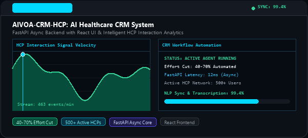
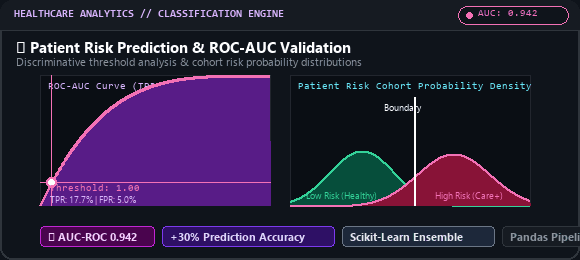
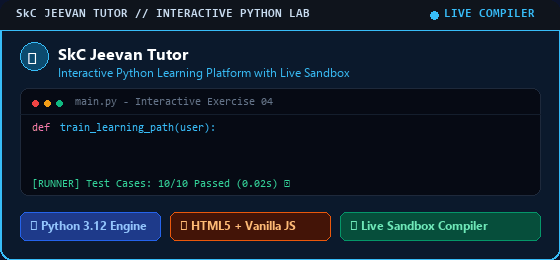
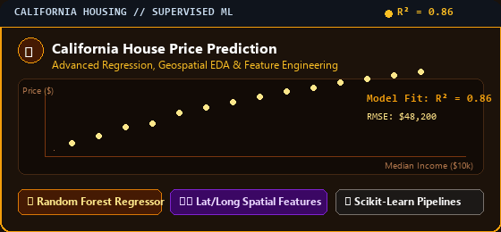
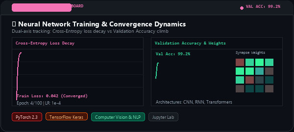
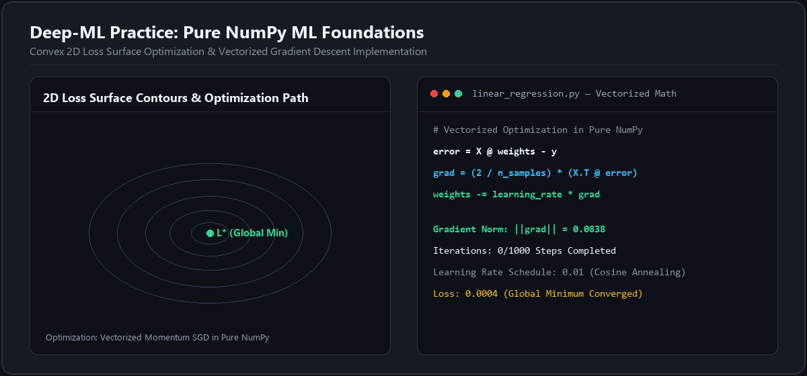

<!-- Animated Header Banner -->

<!-- Typing animation -->

 

<!-- Social Badges -->

  

---

  

---

## 🧠 About Me

<table width="100%">
<tr>
<td width="55%" valign="top" style="padding: 20px;">

### 👋 Hi, I'm Jeevan!

🎯 **Data Scientist & AI/ML Engineer** with **2+ years** of experience

📍 India 🇮🇳 &nbsp;|&nbsp; 💼 Open to Opportunities

---

### 🚀 What I Do
- 🤖 Build **production-grade LLM Agents** & Agentic Workflows
- 🔗 Architect **RAG Pipelines** with vector search & embedding models
- 📊 Develop **Predictive Analytics** & decision-support models
- 🏥 Deliver **Healthcare AI** & CRM automation solutions
- ⚡ **Cut manual effort by 40–70%** through intelligent automation
- 🎯 **Improved data accuracy by 30%** and supported 500+ users

---

### 💡 Interests
- 🧬 **Generative AI** — LLMs, diffusion models, multimodal systems
- 🔬 **Research** — NLP, computer vision, reinforcement learning
- 🌐 **Open Source** — Contributing to AI/ML tooling
- 📖 **Continuous Learning** — Staying at the frontier of AI

---

> 💼 *Skilled in data preparation, feature engineering, statistical analysis, model validation, and end-to-end delivery. Turns operational problems into measurable analytical solutions.*

</td>
<td width="45%" valign="middle" align="center" style="padding: 16px;">

<!-- 3D AI/ML Engineer Animated Avatar (waves Hi → presents interests) -->

</td>
</tr>
</table>

---

## 🛠️ Key Skills & Tech Architecture

  

---

## 💼 Experience

<table width="100%">
<tr>
<td width="50%" valign="top">

### 🚀 Current Focus
- 🤖 **LLM Agent Development** — Autonomous agents with LangGraph & LangChain for complex multi-step reasoning
- 🔗 **RAG Pipelines** — Retrieval-augmented generation with vector databases
- 🏥 **Healthcare AI** — Intelligent CRM systems for HCP interaction tracking
- 📊 **Predictive Modeling** — End-to-end ML pipelines from ingestion to deployment

</td>
<td width="50%" valign="top">

### 🎯 Core Expertise

</td>
</tr>
</table>

---

## 🚀 Featured Projects

<table>
<tr>
<td width="50%" valign="top">

### 🏥 [AIVOA-CRM-HCP](https://github.com/vakajeevanreddy/AIVOA-CRM-HCP)
> **AI-Powered Healthcare CRM**

AI-powered CRM system for documenting Healthcare Professional (HCP) interactions. Built with React frontend and FastAPI backend, enabling interaction logging, analytics, and workflow automation.

**Tech Stack:**

</td>
<td width="50%" valign="top">

### 🧠 [Customer Health Care CRM App](https://github.com/vakajeevanreddy/Customer_Health_care_crm_app)
> **Intelligent Customer Analytics**

End-to-end ML-powered CRM application for patient health tracking. Combines predictive analytics, patient risk stratification, and automated data pipelines for clinical decision support.

**Tech Stack:**

</td>
</tr>
<tr>
<td width="50%" valign="top">

### 📚 [SkC_Jeevan_Tutor](https://github.com/vakajeevanreddy/SkC_Jeevan_Tutor)
> **Interactive Python Learning Platform**

A web-based interactive Python learning tutorial offering structured lessons, live browser-based code execution sandbox, and automated test-case evaluation.

**Tech Stack:**

</td>
<td width="50%" valign="top">

### 🏠 [California House Price Prediction](https://github.com/vakajeevanreddy/California_house_price_pred)
> **ML Regression Model**

End-to-end machine learning project predicting California housing prices using advanced regression techniques. Includes EDA, feature engineering, and model tuning.

**Tech Stack:**

</td>
</tr>
<tr>
<td width="50%" valign="top">

### 🤖 [Deep Learning Projects](https://github.com/vakajeevanreddy/Deeplearning_projects)
> **Neural Network Experiments**

A collection of deep learning implementations including CNNs, RNNs, transformers, computer vision, NLP architectures, and custom loss convergence tracking.

**Tech Stack:**

</td>
<td width="50%" valign="top">

### 📐 [Deep-ML Practice](https://github.com/vakajeevanreddy/deep-ml)
> **ML Algorithm Implementation**

Hands-on ML practice from Deep-ML platform — implementing core ML algorithms from scratch in pure NumPy to master gradients, loss surfaces, and optimization.

**Tech Stack:**

</td>
</tr>
</table>

---

## 📊 Live GitHub Analytics

<!-- Custom Animated Streak Dashboard (fire counter + contribution bars) -->

  

<!-- GitHub Stats + Top Languages -->

  

<!-- AI/ML Code Velocity Dashboard -->

---

## 🌐 Connect With Me

&nbsp;

&nbsp;

  

> 💬 *"The best way to predict the future is to build it."*
>
> Open to **AI/ML roles**, **LLM engineering** opportunities, and **interesting collaborations**. Let's connect! 🤝

---

